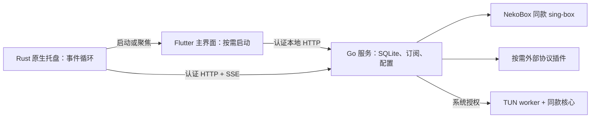

# 实现架构

一个用户数据目录对应一组进程，通过文件锁确保单实例。用户数据目录默认是 macOS `~/Library/Application Support/ShadowBox`、Windows `%APPDATA%/ShadowBox`、Linux `$XDG_CONFIG_HOME/ShadowBox` 或 `~/.config/ShadowBox`。

后台绑定随机 IPv4 loopback 端口，以 192-bit 随机 Bearer token 验证；发现文件仅供本用户读取（Unix 0600；Windows 继承用户目录 ACL）。拒绝非 loopback 和包含 Origin 的请求。UI 和托盘不会开放 HTTP 页面或远程控制接口。SQLite 只有 Go 服务写入，WAL 模式。

Flutter 每秒刷新状态的计时器仅随界面进程存在。Rust 用阻塞 SSE 和原生事件循环等待状态变化，关闭界面后不轮询连接明细。界面子进程由专门 wait 线程及时回收；再次打开创建新 Flutter 进程。托盘退出和 macOS Command-Q 先请求服务停止网络并恢复设置，失败时保留托盘显示错误；关闭窗口仅退出 Flutter。

macOS 外层应用由托盘作为入口，`LSUIElement=true`；Flutter 是 `Contents/Helpers/ShadowBox UI.app` 内的独立应用，使用不同 bundle identifier。只在主界面运行时显示 Dock 图标；关闭后整个辅助应用退出。独立打开辅助界面时，Command-Q 也会等待后台完成网络清理后结束。

macOS 用户权限不足或安全设置要求时，系统代理更改会通过系统授权对话框执行固定的 networksetup 命令；不提升后台服务权限。

系统代理保存修改前快照，只恢复仍指向本软件地址和端口的项，避免覆盖用户后来做的调整。恢复失败保留恢复文件，下次启动或退出重试。后台异常退出由托盘重启，恢复残留系统代理；默认停止代理、允许正常网络访问，只有启用“启动时自动连接”才自动重连。这不是断网保护/kill switch。

TUN 使用同一 Go 程序的 `tun-worker` 子命令，通过 macOS 系统授权、Linux pkexec、Windows UAC 提权。配置文件私有；拒绝可访问本地文件、额外服务和外部规则集的高权限配置；插件始终在普通用户服务中运行。外部插件远端 IP 在 TUN 建立前解析并加入排除路由，防止其流量回到 TUN。worker 每秒检查服务心跳和停止文件，丢失心跳超过 5 秒主动关闭核心。

网络模式、DNS 或分流设置变化会重建连接；失败会尝试恢复旧设置。手动切换节点也会重建连接，现有 TCP 会话可能断开。订阅更新不会偷偷切换正在运行的节点。旧节点若仍在使用或被代理链引用，会保留到“订阅已移除”分组。

外部程序路径必须由用户在本机选定。订阅只提供经过限制的网络参数，不能指定执行文件；只启动当前节点/代理链所需的插件。当前未捆绑插件下载器、插件签名更新器和持久安装的特权服务。

GUI 仅复用模型与控制协议；未来移动端仍需 Android VPNService / iOS NetworkExtension 等原生实现，桌面 TUN 权限方案不能原样移植。
